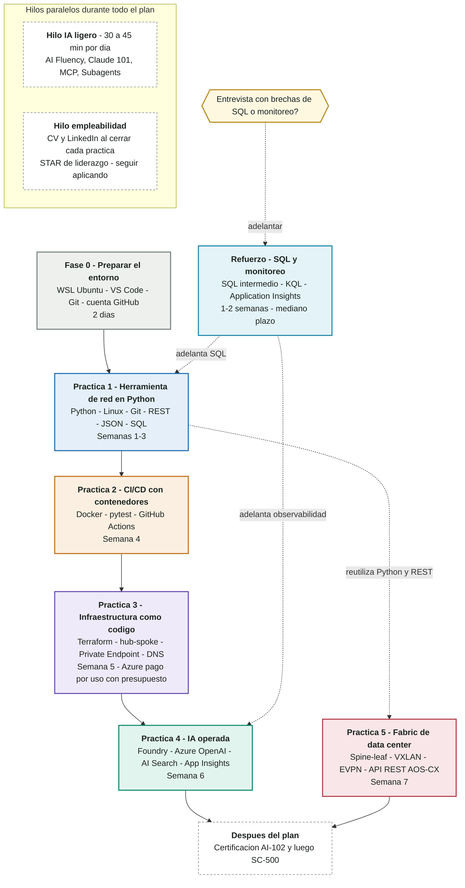

# Ruta Nube e IA

Ingeniero electronico con mas de 20 anos en operaciones de red, testing y soporte Azure,
documentando mi transicion hacia ingenieria de nube, automatizacion e IA.

Plan de capacitacion en 5 practicas para cerrar brechas tecnicas en Python, Linux, Git, REST, SQL,
Docker, CI/CD, Terraform, IA en Azure y VXLAN/EVPN. Cada practica deja un proyecto en su carpeta.

Regla: el curso es la guia, el proyecto es la prueba.

Inicio: octubre 2026.

## About (English)

Electronics engineer with 20+ years in network operations, testing and Azure support, documenting
my transition into cloud engineering, automation and AI. This repository holds 5 hands-on projects:
a Python network tool, CI/CD with containers, Terraform on Azure, an AI agent on Azure AI Foundry,
and a VXLAN/EVPN data center fabric.

## Avance

- [ ] [Fase 0 - Preparar el entorno](fase-0-entorno/)
- [ ] [Practica 1 - Herramienta de red en Python](practica-1-netcheck/)
- [ ] [Practica 2 - CI/CD con contenedores](practica-2-cicd/)
- [ ] [Practica 3 - Infraestructura como codigo](practica-3-terraform/)
- [ ] [Practica 4 - IA operada](practica-4-ia/)
- [ ] [Practica 5 - Fabric de data center](practica-5-vxlan/)
- [ ] [Refuerzo - SQL y monitoreo](refuerzo-sql-monitoreo/)
- [ ] Certificacion AI-102
- [ ] Certificacion SC-500

## Carpetas

| Carpeta | Contenido | Semanas |
|---|---|---|
| [`fase-0-entorno`](fase-0-entorno/) | WSL, VS Code, Git, GitHub | 2 dias |
| [`practica-1-netcheck`](practica-1-netcheck/) | Herramienta de red en Python: REST, JSON, SQLite, reporte | 1-3 |
| [`practica-2-cicd`](practica-2-cicd/) | Docker, pruebas con pytest, GitHub Actions | 4 |
| [`practica-3-terraform`](practica-3-terraform/) | Terraform en Azure: hub-spoke, Private Endpoint, Private DNS | 5 |
| [`practica-4-ia`](practica-4-ia/) | Agente en Foundry con RAG y monitoreo en App Insights | 6 |
| [`practica-5-vxlan`](practica-5-vxlan/) | Spine-leaf con VXLAN/EVPN en AOS-CX y automatizacion REST | 7 |
| [`refuerzo-sql-monitoreo`](refuerzo-sql-monitoreo/) | SQL intermedio, KQL y Application Insights | 1-2, mediano plazo |

## Reglas del repositorio

- Nombres de archivos y carpetas en minusculas, con guiones, sin espacios, sin tildes y sin enes.
- Nunca subir claves, contrasenas ni archivos `.env` con secretos.
- Usar `.gitignore` para excluir `.env`, `venv/` y `__pycache__/`.

## Contacto

- LinkedIn: [Jose Luis Ardila](https://www.linkedin.com/in/joseluisardila)
- GitHub: [jlrdlab](https://github.com/jlrdlab)
